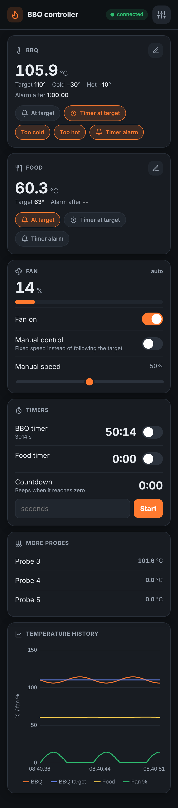
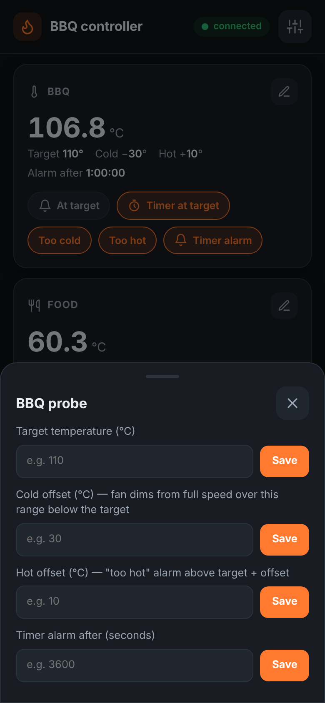
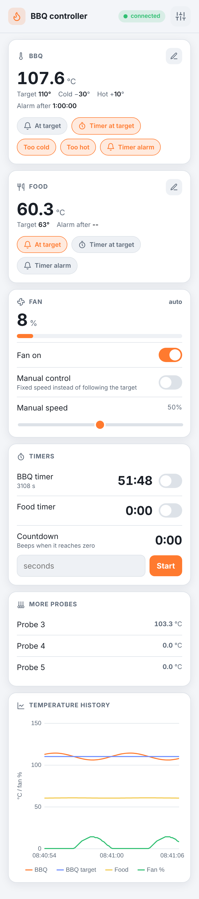

# BBQ controller

ESP32 (Wemos D1 mini32) BBQ controller: reads PT100 (MAX31865) or thermocouple (MAX6675)
probes, drives the fan with PWM, shows the temperatures on an SSD1306 OLED and serves a web
interface over websockets.

| Dashboard | Settings | Light theme |
| --- | --- | --- |
|  |  |  |

## Works without internet (soft-AP mode)

When the stored wifi network can't be reached, the controller starts its own access point
`ESP32-AP`. Connect your phone to it and open `http://192.168.4.1`.

- The web page and everything it needs (styles, icons, chart) is served by the ESP32 itself;
  nothing is downloaded from the internet.
- In soft-AP mode the controller answers every DNS lookup itself (captive portal), so most
  phones show a "sign in to network" message that opens the controller page directly.
- The page shows a `connected` / `offline` badge and reconnects by itself when the phone
  wakes up or comes back into range.

## Finding the controller: companion app

The controller announces itself so you don't have to remember its IP address:

- `GET /info` returns `{"type":"bbq","name":"BBQ controller","id":"a1b2c3","version":"2.0","mode":"sta"|"ap","ip":"..."}`
- mDNS: `bbq-<id>.local`, service `_espdevice._tcp`

The [ESP Device Hub app](https://github.com/Jory81/diy_app_engine/tree/main/app) uses this to find all your ESP32 devices (BBQ controller,
greenhouse, ...) on your home wifi or on the `ESP32-AP` network and opens their page.

## Flashing

Ready-made binaries are in [firmware/](firmware/). Or build it yourself; the files in `data/`
must be uploaded to SPIFFS as well, after every change to them:

```
pio run -e wemos_d1_mini32 -t upload      # firmware
pio run -e wemos_d1_mini32 -t uploadfs    # web page (data/ folder)
```
