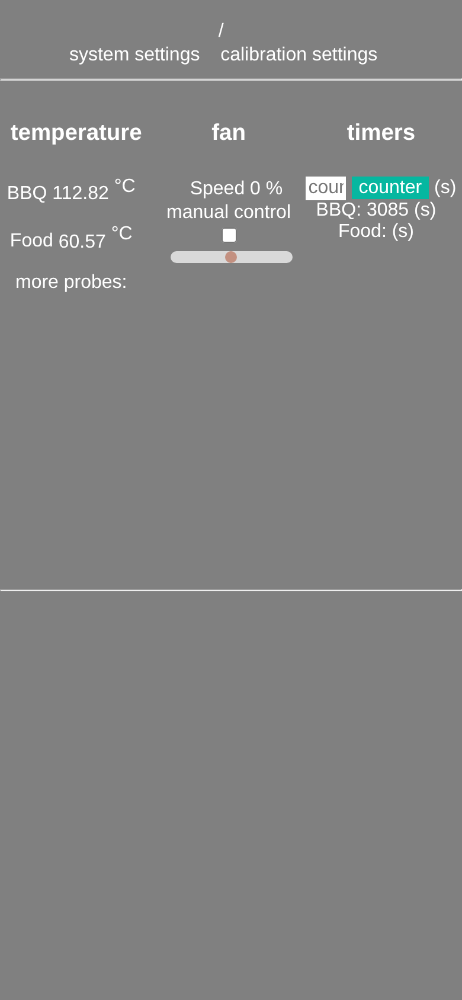
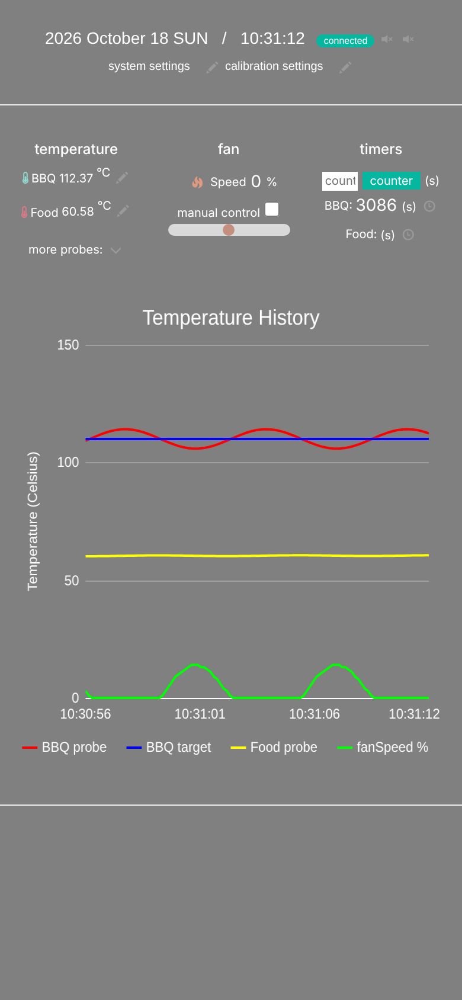

# BBQ controller

ESP32 (Wemos D1 mini32) BBQ controller: reads PT100 (MAX31865) or thermocouple (MAX6675)
probes, drives the fan with PWM, shows the temperatures on an SSD1306 OLED and serves a web
interface over websockets.

## Works without internet (soft-AP mode)

When the stored wifi network can't be reached, the controller starts its own access point
`ESP32-AP`. Connect your phone to it and open `http://192.168.4.1`.

- The web page and everything it needs (styles, icons, chart) is served by the ESP32 itself,
  nothing is downloaded from the internet. Before, icons, the chart and the clock were loaded
  from CDNs and simply broke (or made the page hang) in soft-AP mode.
- In soft-AP mode the controller answers every DNS lookup itself (captive portal), so most
  phones show a "sign in to network" message that opens the controller page directly.
- The page shows a `connected` / `offline` badge and reconnects by itself when the phone
  wakes up or comes back into range.

| soft-AP, before | soft-AP, now |
| --- | --- |
|  |  |

More screenshots in [docs/screenshots](docs/screenshots).

## Uploading

The files in `data/` must be uploaded to SPIFFS as well, after every change to them:

```
pio run -e wemos_d1_mini32 -t upload      # firmware
pio run -e wemos_d1_mini32 -t uploadfs    # web page (data/ folder)
```
